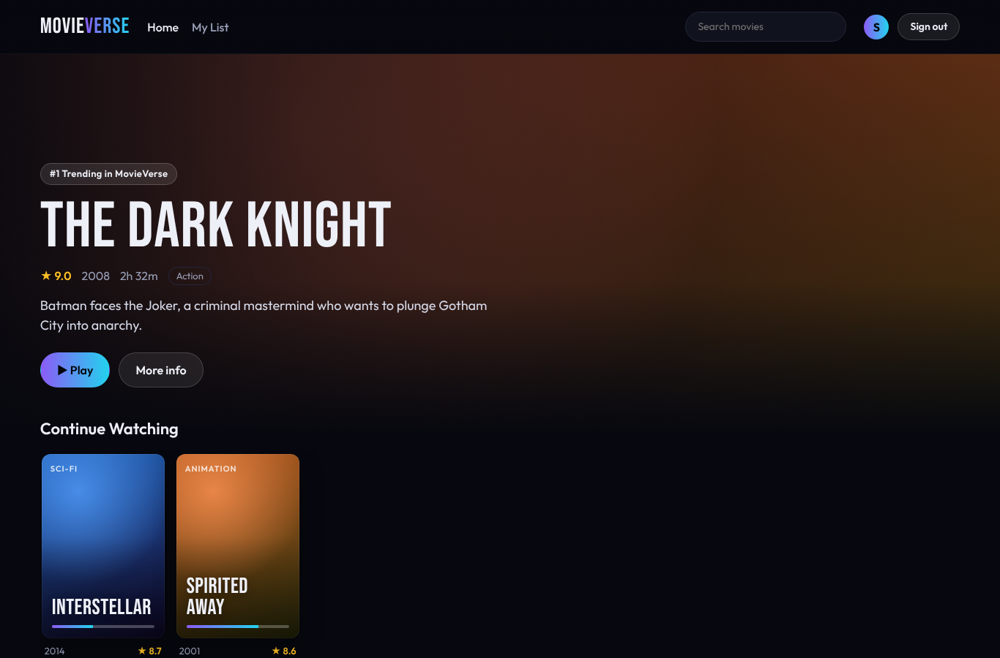
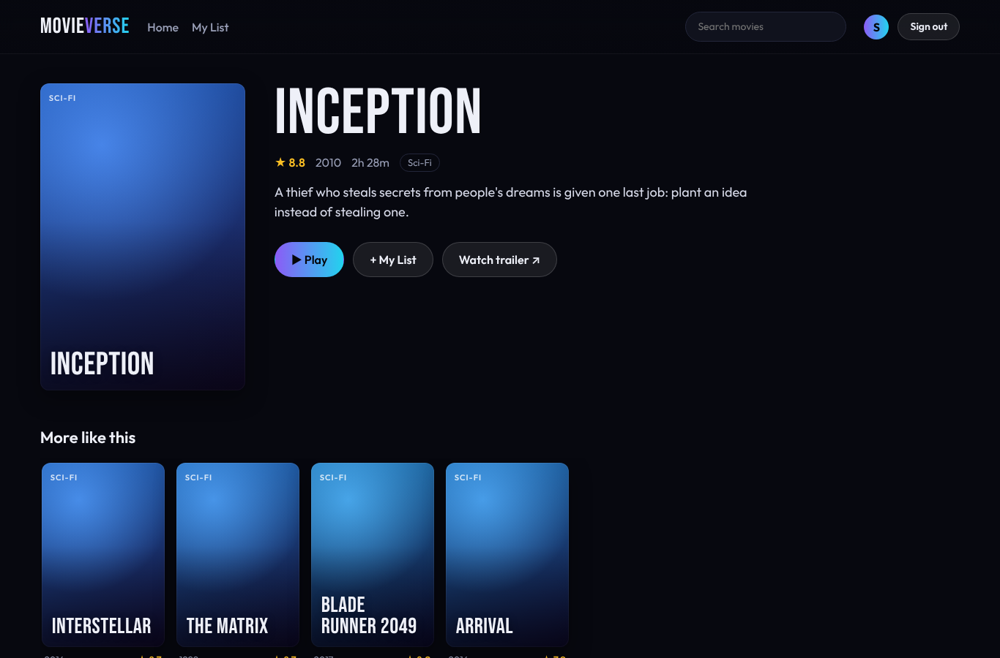
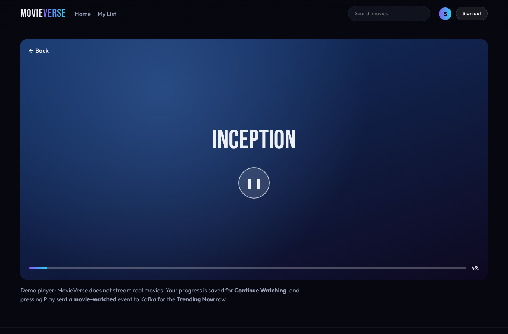
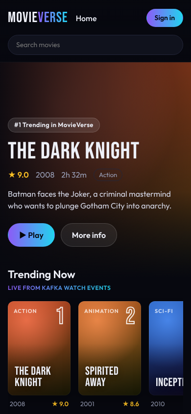
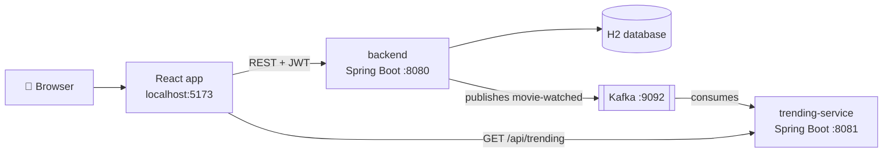

# 🎬 MovieVerse

A full-stack movie streaming website: browse movies by genre, sign up, save movies to **My List**, pick up where you left off with **Continue Watching**, and see what's popular in a **Trending Now** row that updates live from **Kafka** events.

**Tech:** Java 21 · Spring Boot 3.5 · Spring Security (JWT) · Spring Data JPA · H2 · Apache Kafka · React 19 · Vite · Docker · Git



| Movie details | Player | Phone |
|---|---|---|
|  |  |  |

---

## ✨ Features

- **Browse** 25 movies in rows by genre, with search
- **Sign up / sign in** with username and password (BCrypt-hashed passwords, JWT tokens)
- **My List**: save movies to watch later
- **Continue Watching**: the player saves your progress; unfinished movies appear on the home page
- **Trending Now**: every time someone presses Play, the backend publishes an event to Kafka. A separate **trending service** consumes the events, counts views and serves the top 10
- Responsive design that works on phones
- Clean JSON error messages (404, 400, 401) and API tests

## 🏗️ Architecture



The backend and the trending service never call each other. They only share the **movie-watched** Kafka topic. This is **event-driven architecture**: the backend doesn't need to know who is listening, so new services (recommendations, analytics, notifications) can be added later without changing it.

The trending service keeps counts in memory. On startup it re-reads all past events from Kafka (new consumer group + `earliest` offset), so the counts are rebuilt after a restart.

## 📁 Project structure

```
movieverse/
├── backend/            Spring Boot API: movies, auth, My List, watch progress, Kafka producer
├── trending-service/   Spring Boot service: Kafka consumer + /api/trending
├── frontend/           React (Vite) website
├── docker-compose.yml  Runs Kafka
└── docs/               Screenshots
```

Inside `backend/src/main/java/com/movieverse/backend/`, code is grouped by feature:

| Package | What's inside |
|---|---|
| `movie` | `Movie` entity, repository, service, controller, starter data |
| `auth` | Users, register/login, JWT token creation |
| `mylist` | My List endpoints |
| `watch` | Watch progress, Continue Watching, Kafka event publisher |
| `config` | Security rules, JWT and CORS setup |
| `common` | Global error handling |

## 🚀 How to run

**You need:** Java 21+, Node.js 20.19+ (or 22+), and Docker Desktop (for Kafka). Commands below are for Git Bash.

**1. Start Kafka**
```bash
docker compose up -d
```

**2. Start the backend** (new terminal)
```bash
cd backend
./mvnw spring-boot:run
```
The first run downloads Maven and the libraries, so it takes a few minutes. API runs on http://localhost:8080.

**3. Start the trending service** (new terminal)
```bash
cd trending-service
./mvnw spring-boot:run
```
Runs on http://localhost:8081.

**4. Start the website** (new terminal)
```bash
cd frontend
npm install
npm run dev
```
Open http://localhost:5173, create an account and press Play on a movie. It will show up in **Trending Now** and **Continue Watching**.

> **No Docker?** The site still works without Kafka. Set `movieverse.kafka.enabled=false` in `backend/src/main/resources/application.properties` and skip steps 1 and 3; only the Trending row will be empty.

**Run the tests**
```bash
cd backend && ./mvnw test
cd trending-service && ./mvnw test
```

## 🔌 API

**backend (port 8080)**

| Method | Endpoint | Login | Description |
|---|---|---|---|
| GET | `/api/movies` | – | All movies. Optional `?genre=Drama` or `?search=dark` |
| GET | `/api/movies/{id}` | – | One movie (404 if not found) |
| GET | `/api/movies/genres` | – | List of genres |
| POST | `/api/auth/register` | – | `{"username","password"}` → `{"token","username"}` |
| POST | `/api/auth/login` | – | Same as above |
| GET | `/api/my-list` | ✅ | My saved movies |
| POST / DELETE | `/api/my-list/{movieId}` | ✅ | Add / remove a movie |
| POST | `/api/watch/{movieId}/start` | ✅ | Pressed Play: saves progress and publishes a Kafka event |
| PUT | `/api/watch/{movieId}` | ✅ | `{"progressPercent": 40}` |
| GET | `/api/watch/continue` | ✅ | Continue Watching list |

Protected endpoints need the header `Authorization: Bearer <token>`.

**trending-service (port 8081)**

| Method | Endpoint | Description |
|---|---|---|
| GET | `/api/trending?limit=10` | Most played movies: `[{"movieId","title","views"}]` |

**Kafka event** (topic `movie-watched`, key = movie id):
```json
{"movieId": 1, "movieTitle": "Inception", "username": "supun", "watchedAt": "2026-10-19T10:00:00Z"}
```

## 🧠 What I learned

- Building REST APIs with Spring Boot, using layers (controller → service → repository)
- Saving data with JPA entities and relationships (`@ManyToMany`, `@ManyToOne`)
- Stateless authentication with Spring Security, BCrypt and JWT
- Event-driven microservices with Kafka producers and consumers
- React components, hooks, routing and context for login state
- Writing API tests with MockMvc
- Using Git and GitHub for version control

## 🔭 Ideas for next steps

- Switch H2 to PostgreSQL and run every service with Docker Compose
- Real posters and trailers from the TMDB API
- Personalized recommendations as a third Kafka consumer
- Deploy online (e.g. Render / Railway for the APIs, Vercel / Netlify for React)

## ⚖️ Note

MovieVerse is a learning and portfolio project. It does not stream real movies, and movie titles and short descriptions are used only for demonstration. Posters are generated colour gradients and "Watch trailer" opens a YouTube search.
